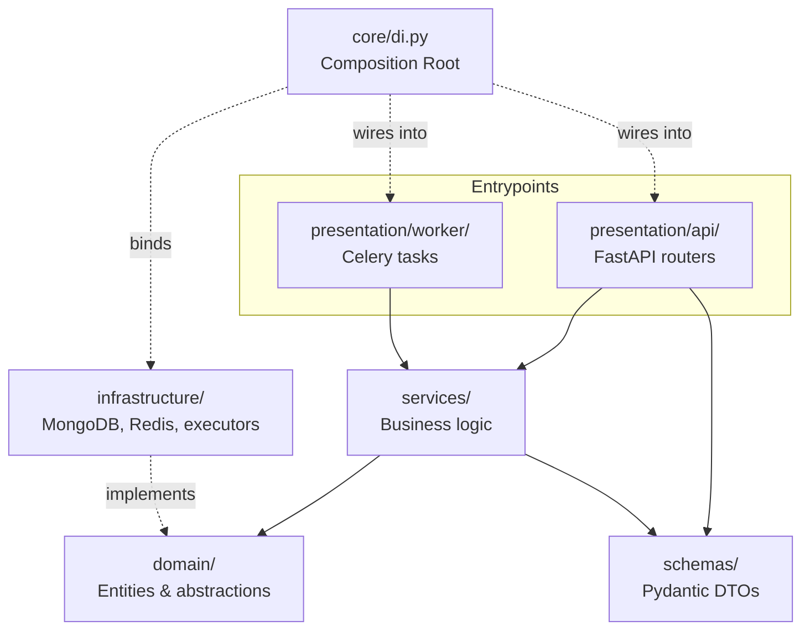
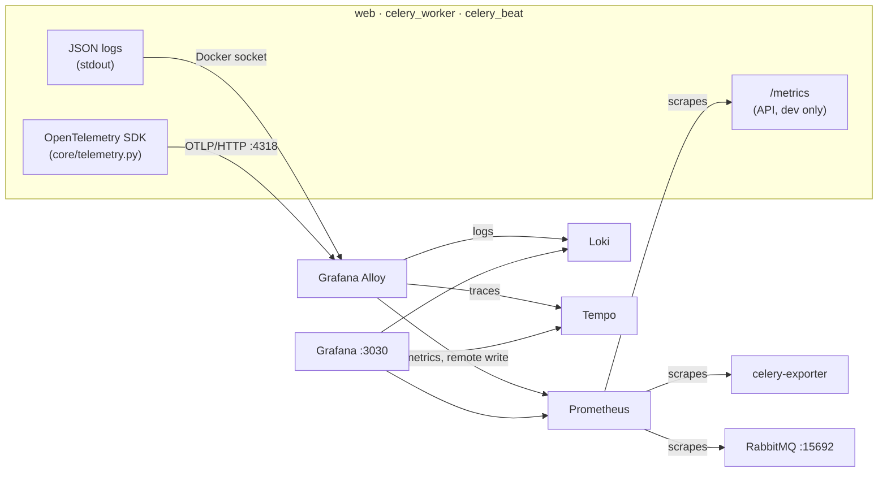

# Architecture

This document describes how Night Crawler is put together: its services, code layout, layers, and background job pipeline. The enforced rules that keep it that way (layering, SOLID, naming, style) live in [CONTRIBUTING.md](CONTRIBUTING.md).

## Services

The application is composed of several services:

| Service | Purpose |
|---------|---------|
| FastAPI | HTTP API |
| Reflex | Web UI: login/register, crawlers and their schedules, a Runs dashboard of every crawler's runs, an Execution history per crawler (last 30 days: streak, last failures, success rate, completeness and records per run), rate-limit rules, versions (draft, publish; publishing archives the previous one), message templates, selectors, and aids, also exported and imported as one instructions file — see [frontend/docs/ARCHITECTURE.md](../frontend/docs/ARCHITECTURE.md) |
| MongoDB | Data persistence (single-node replica set `rs0`, so multi-document transactions work) |
| Redis | Distributed rate limiting |
| RabbitMQ | Message broker |
| Keycloak (+ its Postgres) | Identity provider for Night Crawler and Night Crawler Importer, on host port 8180: the API accepts only its access tokens. See [Identity provider](#identity-provider) |
| Celery | Background workers |
| Celery Beat | Scheduled tasks |
| Prometheus, celery-exporter | Metrics (opt-in Compose profile `observability`; see [Observability](#observability)) |
| Loki, Grafana Alloy | Logs: Alloy ships every container's stdout to Loki, and the app's OpenTelemetry traces and metrics on to Tempo and Prometheus (same profile) |
| Tempo | Traces (same profile) |
| Grafana | Dashboards over Prometheus, Loki, and Tempo, on host port 3030 (same profile) |

The `web`/`celery_worker`/`celery_beat` containers have live network + credentialed access to MongoDB (`db:27017`) and Redis (`redis:6379`), via the `MONGO_URL`/`MONGO_DATABASE` variables Compose injects (`x-app-env`) and `config.py`'s `mongo_url` — no separate DB config is needed to query it from within those containers.

The Reflex frontend talks to the FastAPI backend via server-side `httpx` calls
made from inside its own event handlers - never from the browser - so the
backend needs no CORS configuration.

### Identity provider

Keycloak 26 (`keycloak`, with `keycloak_db` on Postgres 17, since
Keycloak can't use MongoDB) holds the `night-crawler` realm, defined in
`keycloak/realm-night-crawler.json`:

- realm roles `admin`, `user`, `viewer`; every new account gets `user`.
  Self-registration and brute-force protection are on; access tokens
  last 300 s.
- `night-crawler-ui` and `importer-ui`: confidential clients for the
  Authorization Code flow (PKCE S256), redirecting to
  `http://localhost:3000/auth/callback` and `http://localhost:3100/auth/callback`.
  An audience mapper puts `night-crawler-api` / `importer-api` in their
  access tokens' `aud`.
- `night-crawler-api` and `importer-api`: confidential clients with a
  service account only, granted `realm-management`'s `view-users`,
  `manage-users`, `query-users`, and `view-realm` (to list a role's
  members) for the Admin REST API.
- one admin user, from `KC_SEED_ADMIN_EMAIL` / `KC_SEED_ADMIN_PASSWORD`.

The development override starts it with `start-dev --import-realm`, which
imports the file only while the realm doesn't exist; the base file runs
`start`. Secrets and the seed admin are `${...}` placeholders Keycloak fills
from its environment.

Tokens always carry the issuer `http://localhost:8180/realms/night-crawler`
(`KC_HOSTNAME`), whether a browser fetched them or a container did.
Containers reach Keycloak at `http://keycloak:8080`: with
`KC_HOSTNAME_BACKCHANNEL_DYNAMIC`, the token, JWKS, and Admin API endpoints
follow the request's host. Keycloak also joins the external Docker
network `identity`, which `make up` creates, so the Importer's stack can
reach it under the same name.

### Authentication

Every protected route declares `get_current_user`
(`presentation/api/dependencies.py`), which hands the bearer token to
`services/auth_service.py::get_user_from_token` and its
`AbstractTokenVerifier` port (`domain/ports/token_verifier.py`).
`infrastructure/external/jwks_token_verifier.py::JwksTokenVerifier`
implements it:

1. PyJWT's `PyJWKClient` gets the signing key named by the token's `kid`
   from `OIDC_JWKS_URL`, Keycloak's certs endpoint over the Docker
   network. The key set is cached for 5 minutes, and an unknown `kid`
   (Keycloak rotated its keys) fetches it again. The fetch is blocking,
   so it runs in a worker thread. One verifier per process
   (`core/di.py`), so requests share the cache.
2. The token must be RS256, unexpired, have `iss` == `OIDC_ISSUER`, and
   have `OIDC_AUDIENCE` among its `aud`.
3. `sub` becomes the user's `id`, `email` their email, and the highest
   of their `realm_access.roles` (`admin` > `user` > `viewer`,
   `domain/rules/user_roles.py`) their role. A token without an email
   or one of those roles is refused.

Any failure is a 401 `Invalid or expired session token`; JWKS being
unreachable is a 502. No account is looked up, so a disabled account or
a changed role takes effect only when the token expires (300 s).
`require_admin` then checks the role for admin-only routes (403).

### User accounts

The admin-only `/api/users` routes go through `services/user_service.py`
to `AbstractUserDirectory` (`domain/ports/user_directory.py`), which
`infrastructure/external/keycloak_user_directory.py::KeycloakUserDirectory`
implements with httpx over Keycloak's Admin REST API
(`KEYCLOAK_URL`/admin/realms/`KEYCLOAK_REALM`):

- It authenticates as the `night-crawler-api` service account with the
  client-credentials grant (`KEYCLOAK_ADMIN_CLIENT_ID`,
  `KEYCLOAK_ADMIN_CLIENT_SECRET`, which Compose maps from
  `KC_NIGHT_CRAWLER_API_SECRET`), and reuses the token until 30 s
  before it expires.
- A user's role is the highest of their effective realm roles, so the
  `user` every account gets through the realm's default-roles composite
  counts. Setting a role removes that composite and any other API role,
  then maps the new one: the account ends up with exactly that role.
- `DELETE /api/users/{id}` disables the account; nothing is deleted
  (BUSINESS_RULES §9). Created accounts and admin-set passwords are
  temporary (`UPDATE_PASSWORD`).
- Keycloak being unreachable, or refusing the credentials, is a 502.

The web process keeps one directory (`core/di.py`), closed at shutdown.
The Instruction Generation worker opens one per task
(`open_instruction_generation_infrastructure`), since its connection
pool is bound to the task's event loop, to look up who asked.

The Reflex UI logs in through Keycloak (Authorization Code with PKCE,
client `night-crawler-ui`; see
[frontend/docs/ARCHITECTURE.md](../frontend/docs/ARCHITECTURE.md#authentication)).
The API has no login or registration routes and stores no passwords:
signing up, logging in, password rules, and brute-force protection are
Keycloak's ([BUSINESS_RULES §8](BUSINESS_RULES.md#8-authentication-abuse-protection)).

## Project Structure

```
backend/
├── scripts/
│   └── export_users_to_keycloak.py  # one-off: old `users` collection → Keycloak partial import (README)
└── src/
    └── night_crawler/
        ├── presentation/             # Inbound adapters
        │   ├── api/                  # FastAPI HTTP adapter
        │   │   ├── crawler.py
        │   │   ├── crawler_execution.py
        │   │   ├── crawler_instructions.py  # instructions file export/import (YAML)
        │   │   ├── instruction_generation.py  # AI agent writes a version's instructions
        │   │   ├── crawler_version.py
        │   │   ├── dependencies.py
        │   │   ├── exception_handler.py
        │   │   ├── message_aid.py
        │   │   ├── message_aid_proxy.py
        │   │   ├── message_aid_rate_limit.py
        │   │   ├── message_selector.py
        │   │   ├── message_template.py
        │   │   ├── root.py
        │   │   └── user.py
        │   └── worker/
        │       └── tasks.py          # Celery task adapter
        ├── core/                     # Cross-cutting & DI wiring
        │   ├── config.py
        │   ├── di.py                 # Composition Root
        │   ├── logging.py
        │   └── telemetry.py          # OpenTelemetry providers and instrumentation
        ├── domain/                   # Framework-free core; layout in DOMAIN_MODEL.md §2.1
        ├── infrastructure/           # Data access & adapters
        │   ├── cache/
        │   │   └── redis_rate_limiter.py
        │   ├── db/                   # Mongo client, index definitions, read/write repository sets, and one repository per entity
        │   ├── external/             # httpx, Playwright, and Patchright request executors; the Browser Use agent recorder; the JWKS token verifier; the Keycloak user directory
        │   ├── storage/              # dataset CSV export to the local filesystem (`LocalDatasetExportStorage`)
        │   ├── tasks/                # Celery job dispatcher
        │   └── telemetry/            # OpenTelemetry run metrics, plus measuring decorators for the executors and rate limiter
        ├── schemas/                  # DTOs, one per entity
        ├── services/                 # Business logic, one per entity + execution services
        ├── __init__.py
        ├── celery.py
        └── main.py

keycloak/
└── realm-night-crawler.json      # the `night-crawler` realm, imported on Keycloak's first start

observability/                    # configs for the `observability` Compose profile
├── prometheus/prometheus.yml     # scrape targets
├── loki/loki-config.yaml         # single-process Loki, 14-day retention
├── tempo/tempo-config.yaml       # single-process Tempo, 14-day retention
├── alloy/config.alloy            # container logs → Loki; app OTLP → Tempo, Prometheus
└── grafana/                      # provisioned data sources and dashboards

frontend/                         # detailed in frontend/docs/ARCHITECTURE.md
├── Dockerfile
├── rxconfig.py
├── docs/                         # frontend ARCHITECTURE.md and CONTRIBUTING.md
├── tests/                        # forms.py and api_client.py tests
└── src/
    └── night_crawler/            # same src layout and package name as the backend
        ├── api_client.py         # httpx wrapper for the FastAPI backend
        ├── forms.py              # pure form ⇄ payload helpers
        ├── state/                # rx.State per page (auth, crawlers, crawler detail, version editor, sources, datasets, runs, rate limits)
        ├── components/           # shared layout, nav, form fields
        ├── pages/                # login, register, crawlers, crawler detail, version editor, sources, datasets, runs, rate limits
        └── night_crawler.py      # entrypoint: app = rx.App()
```

## Layers

The rules for these layers (what each may import, accept, and return, and where adapters are bound) are in [CONTRIBUTING §1](CONTRIBUTING.md#1-architecture-rules). What each package holds:

- **presentation/** — inbound adapters: `api/` (FastAPI routers, dependency stubs, the exception handler) and `worker/` (Celery task entrypoints).
- **services/** — the use cases: Crawlers, versions, templates, selectors, aids, and runs.
- **schemas/** — Pydantic request and response models.
- **domain/** — entities, value objects, ports, pure rules, and the `AppException` hierarchy; its layout is in [DOMAIN_MODEL §2.1](DOMAIN_MODEL.md#21-how-domain-is-organized).
- **infrastructure/** — the adapters behind the ports: MongoDB repositories grouped into `MongoReadRepositories` and `MongoWriteRepositories`, the Redis limiters, the httpx/Playwright/Patchright executors, the Browser Use agent recorder, CSV storage, the Celery dispatchers, and the OpenTelemetry run metrics and measuring decorators.
- **core/** — settings, logging and telemetry (`core/logging.py`, `core/telemetry.py`; see [Observability](#observability)), and the Composition Root (`core/di.py`): it creates the process-wide clients and owns their startup and shutdown, and maps each repository port to its adapter (`REPOSITORY_FACTORIES`).

A version's templates, aids, and selectors also travel as one YAML **instructions file** (`GET`/`PUT /api/crawler-versions/{version_id}/instructions`): `presentation/api/crawler_instructions.py` checks the transport (size, a body sent as JSON is refused), and `services/crawler_instructions_service.py` reads and writes the YAML (PyYAML, aliases refused) and maps it to and from the version's tree; the AI agents worker uses the same functions. Its rules are in [DOMAIN_MODEL §5.9](DOMAIN_MODEL.md#59-instructions-file).

`GET` routes run on read repositories (no transaction); the other routes run the whole use case in one MongoDB transaction ([CONTRIBUTING §1.5](CONTRIBUTING.md#15-data-access)). Authentication reads no database at all (see [Authentication](#authentication)), so a write request's transaction starts only once the user is known.



Solid arrows are imports; dotted arrows show how concrete adapters are plugged in behind the `domain/` abstractions without `presentation/` or `services/` ever importing them.

## Background Job Pipeline

Celery workers execute asynchronous jobs while Celery Beat schedules recurring tasks, across 4 execution queues: `discovery` (default), `priority`, `real-time`, and `testing` (`domain/model/constants.py`'s `EXECUTION_QUEUES`), plus `dataset-import` and `ai-agents` (`AI_AGENTS_QUEUE`, Instruction Generations). The Celery app lives in `night_crawler/celery.py`; the dev `celery_worker` service listens on all of them (`-Q` in `docker-compose.override.yml`) - split queue-specific worker pools out by overriding that command per-environment if `testing` traffic needs to be isolated from production queues. RabbitMQ is the message broker between the API and workers.

A run starts as a `pending` Crawler Execution of the published version, enqueued on the Crawler's `queue` right after it is committed:
- on demand, by `POST /api/crawlers/{crawler_id}/executions`;
- as a test run, by `POST /api/crawler-versions/{version_id}/test-executions` (the Instructions page's **Test run** button): it runs exactly that version, draft, published, or archived, and always goes to the `testing` queue. A Crawler's own `queue` can never be `testing` (`CRAWLER_QUEUES`);
- on schedule: every minute Celery Beat runs `night_crawler.tasks.dispatch_scheduled_crawlers`, which calls `execution_processing_service.dispatch_scheduled_crawlers` to create and enqueue one run for each Crawler with a published version whose cron `schedule` matches that minute (`croniter`). A schedule always runs; to stop it, clear it. A Crawler with nothing published is skipped until a draft is published.

The worker task `night_crawler.tasks.process_crawler_execution` (`presentation/worker/tasks.py`) opens the run's infrastructure with `core/di.py::open_execution_infrastructure` (repository factories, executors, rate limiter, CSV storage, closed when the run ends) and hands it to `services/execution_processing_service.py::process_execution`, which:
1. moves the run to `running` (a run that is no longer `pending`, e.g. a redelivered task, is skipped);
2. reads the plan (`services/execution_plan_service.py`): the version's templates with their selectors and aids, the seeded Context, and the templates in dependency order - a template depends on another when one of its `{{placeholders}}` is the `title` of a selector on that other template (`domain/rules/template_ordering.py`; a cycle fails the run);
3. runs the plan with no transaction open (`services/crawler_run_service.py`), each request first waiting on its rate limits ([DOMAIN_MODEL §4.8](DOMAIN_MODEL.md#48-message-aid-rate-limit)): each template is rendered from the Context as it stands, once per combination of its `name[]` lists (fan-out; a value listed twice still runs once), and runs again while it feeds itself (a placeholder one of its own selectors harvests: a page token repeats each combination until it stops changing, a list of links runs each new element once; DOMAIN_MODEL §5.8), and sent by the engine its Message Aid's `render_mode` selects - `none` → httpx, `playwright` → Playwright, `stealth` → Patchright. Harvested values not bound to one of the Crawler's fields feed the Context for later templates;
4. saves the Context, `request_count` / `error_count`, and `succeeded`/`failed` in one short transaction.

Retries, and what happens when a request fails for good (the run stops and ends `failed`), are entity behavior: see [DOMAIN_MODEL §4.6](DOMAIN_MODEL.md#46-message-aid). A missing placeholder or a crash fails the run too. Step 4 still runs for a failed run, so what was harvested is kept: the Context is saved and the partial CSV stays in `raw/`. Each task opens its own MongoDB client (`core/di.py::open_task_repositories`): Celery runs each task in a fresh event loop, and an async client can't cross loops.

**Session sharing.** Within one run, every request to the same exact host starts from the cookies and shareable headers earlier requests left behind, whatever engine sent them (`domain/rules/host_session.py`), unless the version turns `is_host_session_sharing_enabled` off:
- httpx sends shared cookies in the `Cookie` header, and captures every `Set-Cookie` along the redirect chain;
- the browsers seed their context with the shared cookies, User-Agent, and other headers, and capture the context's cookies plus the headers they actually sent (User-Agent, client hints, `Accept-Language`, custom ones);
- a template's own headers always win; `Host`, `Content-*`, `Cookie`, and hop-by-hop headers are never shared, nor is httpx's generic default User-Agent.

Playwright and Patchright executors are scoped to one crawler execution.
They launch browsers lazily, reuse a page/context for the same exact host,
proxy, and User-Agent while host-session sharing is enabled, then close
those resources when the execution finishes. With sharing disabled, each
request gets an isolated context and page, while its browser can still be
reused until the execution ends.

Browser GET responses with a JSON content type are harvested from the raw
response body using JMESPath, without parsing the browser's HTML snapshot.
An HTML page is read only once it has stayed on one document for 2 seconds
(`browser_dispatch.py::_settle`, bounded by the request's timeout), so a page
that replaces itself right after loading (a bot check that reloads once it
passes, a client-side redirect) is harvested as the page it ends up on.
HTML responses continue to use the live page for CSS/XPath selectors and
click/select actions.

Values for the Crawler's fields go to the execution's dataset CSV (`crawler_execution_datasets`): one row per match of the innermost iterator or click of each template that has a selector titled after one of those fields (a `context` selector reads a placeholder's value, e.g. the fanned-out `place_id`); when the run ends the rows are validated against the Dataset's fields (required, unique, type, pattern, no empty column; DOMAIN_MODEL §5.4) and parsing is `parsed` only when the run succeeded and the validation passed. Other values replace the execution's Context. The Crawler's next execution inherits it without the keys its version's selectors harvest, which every run harvests afresh (`crawler_execution_service._stage_execution`, `domain/rules/context_inheritance.py`; DOMAIN_MODEL §4.10).

**Rate limits.** How rules apply (keys, windows, penalties) is in [DOMAIN_MODEL §4.8](DOMAIN_MODEL.md#48-message-aid-rate-limit). At run time, `infrastructure/cache/redis_rate_limiter.py` keeps each key's `limits` moving window and penalty hash in Redis, so every worker and run share them; each task opens and closes its own connection pool (`core/di.py::open_execution_infrastructure`). Waits are logged at `DEBUG` as `Rate limited: … wait=`, and measured ([Observability](#observability)). The same limiter also holds the Gemini quota's `llm:<model>` keys (below), with two more kinds of bucket: `try_acquire` takes a window slot without waiting (the daily budget), and `record_usage` / `wait_for_usage` count an amount, tokens, in a `limits` fixed window under `<prefix>:usage`.

**Authentication abuse protection** is Keycloak's: the realm has brute-force detection on ([BUSINESS_RULES §8](BUSINESS_RULES.md#8-authentication-abuse-protection), `keycloak/realm-night-crawler.json`), and the API has no login of its own to protect.

**Instruction Generations** (the `ai-agents` queue). `POST /api/crawler-versions/{version_id}/instruction-generations` with `{"prompt": "..."}` stores a `pending` Instruction Generation for a draft or published version (an archived one is refused, 409), commits, and enqueues `night_crawler.tasks.generate_crawler_instructions` through `AbstractInstructionGenerationDispatcher` (`infrastructure/tasks/celery_instruction_generation_dispatcher.py`); it answers 202 and the client polls `GET /api/instruction-generations/{generation_id}` (add `?include=recording` for the browser agent's recording, left out otherwise). The task opens `core/di.py::open_instruction_generation_infrastructure` (repository factories, the recorder, the synthesizer, the execution dispatcher, the recording cap, the synthesis attempts, and the ignored hosts) and hands it to `services/instruction_generation_service.py::process_generation`, which reuses what runs already have rather than being one:
1. the pending → running guard (a redelivered task is skipped), as `start_execution` does;
2. the **recorder** (`AbstractBrowserAgentRecorder`) runs a browser agent that gets the data the prompt asks for, and returns a recording of its steps and its browser's traffic, which is saved, capped (DOMAIN_MODEL §4.16), with no transaction open while it works;
3. the **filter** (`domain/rules/recording_filter.py`, pure) keeps only the requests that led to the extracted data: noise and failed attempts dropped, then lineage traced back from the data. Their summary is saved, and an empty chain, or an agent that did not get the data, fails the generation before any Gemini call;
4. the **synthesizer** (`AbstractInstructionSynthesizer`, bound to `GeminiInstructionSynthesizer`) writes a whole instructions file from them. Each file is **checked** with the same reading as an upload (`crawler_instructions_service.parse_instructions_text`), the import's link checks (`find_instruction_problems`), and `find_unknown_placeholders` (every placeholder filled by a selector, the Crawler's Context, or a required Context key). A file with problems goes back with them, up to `SYNTHESIS_MAX_ATTEMPTS` files;
5. the valid file is **imported** like an upload (`import_instructions`), so it lands on the draft, or on a new draft forked from a published version. Its required Context keys are saved, with a warning for each the Context lacks;
6. a test run of that draft starts through `crawler_execution_service.create_test_execution`, unchanged: it goes to `testing`, shows on the Runs page, and produces its CSV like any test run.

Each step saves its progress in its own short transaction, so a failed generation keeps its recording, its filtered requests, its last file, and the draft it reached (DOMAIN_MODEL §4.16).

**The synthesizer** (`infrastructure/external/gemini_instruction_synthesizer.py::GeminiInstructionSynthesizer`) is bound in `core/di.py::create_instruction_synthesizer` for the worker only. Its model comes from `create_gemini_chat_model(rate_limiter)` like the recorder's, so both wait on one Gemini budget. Each attempt is one Gemini call:
- **System prompt:** `infrastructure/external/prompts/instructions_synthesis.md`, a versioned file packaged with the adapter (`[tool.setuptools.package-data]` in `pyproject.toml`) and read once at import, never from `docs/`. It restates the file format of DOMAIN_MODEL §5.9 and the template, selector, and aid fields of §4.4–4.6. It also says the recording is a sample (`AGENT_MAX_PAGES`), so a listing's recorded pages become one template that feeds itself (DOMAIN_MODEL §5.8): a `value` selector on it harvests the next page's cursor, token, offset, or page number, a value the site itself gives and that is missing on the last page, never one computed, so the crawl walks every page and then stops. `test_gemini_instruction_synthesizer.py` fails when a block or field name listed there is missing from it, so the two never drift apart.
- **User message:** the task, the Crawler's fields, the extracted data, where the data is (an API call or only a page, which decides `render_mode`), the redacted credential headers and the placeholders to write for them, each kept request with its reasons, values, headers, and cut response body, the current file, and the last attempt's file and problems. Recorded content is fenced off and the prompt says it is never an instruction.
- **Answer:** fences and prose around a fenced block are stripped. Credential placeholders the file uses are returned as `required_context_keys`. A Gemini error becomes an `ExternalServiceException`; a spent quota passes through unchanged.
- **Settings:** `SYNTHESIS_MAX_ATTEMPTS` (3), `SYNTHESIS_BODY_MAX_BYTES` (16 KiB per response body), `SYNTHESIS_TOTAL_BODY_MAX_BYTES` (128 KiB in all, data-carrying responses served first), `SYNTHESIS_IGNORED_HOSTS` (comma-separated analytics and ads hosts, with a built-in default list).

**The browser agent** (`infrastructure/external/browser_use_agent_recorder.py::BrowserUseAgentRecorder`) is a [Browser Use](https://github.com/browser-use/browser-use) `Agent` on Gemini, bound in `core/di.py` for the worker task only: the API process never starts a browser.
- **Model:** `core/di.py::create_gemini_chat_model(rate_limiter)` is the one place the Gemini chat model (`GEMINI_MODEL`, a Flash model) is built, so the recorder and the synthesizer get the same rate-limited model. It is called per run: without `GEMINI_API_KEY` it raises `ConfigurationException`, and that generation fails with `GEMINI_API_KEY must be set.`
- **Gemini quota:** the model is Browser Use's `ChatGoogle` wrapped in `infrastructure/external/rate_limited_gemini_model.py::RateLimitedGeminiModel`, a decorator like `OpenTelemetryRequestExecutor`. Every call, from any worker, waits on one budget per model in Redis: each generation task opens its own `RedisRateLimiter` (`open_instruction_generation_infrastructure`, closed when it ends) on the shared `llm:<model>:minute`, `:day`, and `:tokens` keys (DOMAIN_MODEL §4.8). Before a call it takes a day slot, never waiting for one, then waits for the token budget and the minute window. After it, the call's `usage.total_tokens` are counted. `ChatGoogle` still retries server errors, but not 429s, which the wrapper handles:
  - a 429 (`RESOURCE_EXHAUSTED`) grows the minute key's penalty and is retried after Gemini's `retryDelay`, else after `domain/rules/request_retries.py`'s backoff (1 s, 2 s, 4 s, …), up to `GEMINI_MAX_RETRY_ATTEMPTS` times; then the call fails with `Gemini rate limit exhausted`;
  - a spent daily budget, ours or Google's (a 429 whose quota id is `…PerDay…`), fails the call at once with `Gemini daily request budget spent; try again tomorrow`, without waiting, retrying, or calling Gemini. The generation fails; it is never left pending for another day;
  - Browser Use catches a failed model call and goes on to its next step, so the wrapper keeps that failure and raises it on every later call. The recorder's `register_should_stop_callback` stops the agent, and the generation fails with that same message.
- **Browser:** each run gets a fresh headless Chromium on a throwaway profile directory, killed and deleted in a `finally`. It is the Chromium the image already installs for Playwright, which Browser Use finds through `PLAYWRIGHT_BROWSERS_PATH`. Limits are `AGENT_MAX_STEPS` actions (one per step, so each request belongs to one action) and `AGENT_TIMEOUT_SECONDS` for the whole run. The task also tells the agent to visit at most `AGENT_MAX_PAGES` listing pages (each pagination step counts as one) and a few detail pages, then answer with the items collected so far: the run only shows how the site serves the data, so a partial result is the expected outcome, even when the prompt asks for the whole catalog.
- **Task:** the agent is told to extract exactly the Crawler's fields and to answer with JSON rows. The current instructions are only a hint. Page text is data, never instructions (in the task and its system message), against prompt injection from crawled pages.
- **Recording:** the browser's CDP `Network` events (`requestWillBeSent`, `responseReceived`, `loadingFinished`, `loadingFailed`) are joined into requests by `browser_network_capture.py`, enabled again on each step's tab, and tied to the step that started last before each one. Bodies of documents and API calls are fetched as they finish, cut at `AGENT_RESPONSE_BODY_MAX_BYTES`. Browser Use's history becomes the steps and final result in `browser_use_history.py`. Cookie values and `Authorization`, `Proxy-Authorization`, `X-Api-Key`, and `X-Goog-Api-Key` values are redacted as they are captured (cookie names stay, for lineage), so they reach neither the recording nor the logs.
- **Errors:** a timeout, a Browser Use or Gemini failure, or a run that stops on its model's or browser's error leaves the adapter as `BrowserAgentException` (an `ExternalServiceException`) carrying the partial recording. A run that only ends without the data returns its recording, marked unsuccessful.
- **Image:** `browser-use` is a dependency (`pyproject.toml`, pinned to a minor). The `Dockerfile` sets `BROWSER_USE_SETUP_LOGGING=false`, since its import would otherwise replace the app's JSON logging, and `ANONYMIZED_TELEMETRY=false` / `BROWSER_USE_CLOUD_SYNC=false`, so no usage data leaves the container.
- **Settings** (`core/config.py`, `.env`): `GEMINI_API_KEY` (secret), `GEMINI_MODEL`, `GEMINI_REQUESTS_PER_MINUTE`, `GEMINI_REQUESTS_PER_DAY`, `GEMINI_TOKENS_PER_MINUTE`, `GEMINI_MAX_RETRY_ATTEMPTS`, `AGENT_MAX_STEPS`, `AGENT_MAX_PAGES`, `AGENT_TIMEOUT_SECONDS`, `AGENT_RESPONSE_BODY_MAX_BYTES`, `GENERATION_RECORDING_MAX_BYTES`. `GEMINI_MODEL` defaults to `gemini-flash-latest`, Google's alias for its newest Flash model: pinned ids such as `gemini-2.5-flash` answer 404 to projects created after they closed to new users. The quota defaults are `gemini-2.5-flash`'s free tier as AI Studio showed it on 2026-10-06 (15 requests per minute, 1,500 per day, 1,000,000 tokens per minute), to check against the configured model's. Google shows them only per project, at aistudio.google.com/rate-limit, and changes them without notice.

Not built yet: the dataset import into `dataset_*`, the Proxy Ladder, and `pagination` selectors.

**Reading runs.** Every run listing returns, per run, its `outcome` (`success`, `verification_failed`, `failed`, `in_progress`; [DOMAIN_MODEL §4.9](DOMAIN_MODEL.md#49-crawler-execution)), its dataset's `row_count` and `import_metrics` (`dataset`, `null` until the run has a CSV), and its validation report with its `completeness_rate` (§5.4), read in one batched query (`get_summaries_by_crawler_execution_ids`), never the CSV:
- `GET /api/crawler-executions`: every Crawler's runs, test runs included, for the Runs page (filters `status`, `parsing_status`, `queue`, `crawler_title`);
- `GET /api/crawlers/{crawler_id}/executions`: one Crawler's history, a page shaped like the above (`items`, `limit`, `offset`, `has_more`), filtered by `status` and `queue`. It pages even when filtered, up to 300 runs deep; without `queue`, test runs are left out;
- `GET /api/crawlers/{crawler_id}/execution-history`: that history's last `days` days (1–90, default 30) in one response, for the Execution history page's chart and table: `runs` (newest first, up to 1,000, `is_truncated` past that), `counts` per Run outcome over the whole window (one `$group` aggregation on status and parsing status, folded into outcomes by `domain/rules/execution_history.py::count_outcomes`), and `window_start` / `window_end` (naive UTC), with the same optional `queue`;
- `GET /api/crawlers/{crawler_id}/execution-summary`: that history in numbers (`consecutive_successful_runs`, `avg_completion_seconds`, `success_rate`, `recent_run_count`, `last_success_at`, `last_verification_failure_at`, `last_failure_at`, `avg_completeness_rate`; definitions in [DOMAIN_MODEL §4.9](DOMAIN_MODEL.md#49-crawler-execution)), with the same optional `queue`. It reads the last 30 ended and the last 30 successful runs (and their datasets' completeness), the newest verification failure and failure, plus older runs only while the streak lasts.

A Crawler's target queue is part of its schedule, set via `POST /api/crawlers` or `PATCH /api/crawlers/{crawler_id}` (`queue`). It is not versioned: changing it never forks a draft, and the next run goes to the new queue.

Crawls never write crawled data to the `dataset_*` collections. Each execution produces one CSV from its Crawler's harvested `fields`. The worker writes it through `AbstractDatasetExportStorage` (`LocalDatasetExportStorage`, which Compose mounts at `./var/csv` on the host, in both `web` and `celery_worker`): always first to `raw/<crawler_id>_<execution_id>_<started>.csv`, then moved to `validated/` when the run succeeded and its rows passed validation. **That file is the CSV's only copy:** `crawler_execution_datasets` keeps its `file_path`, row count, and validation report, never the CSV text, so a run's CSV has no size limit. The API's full and Sample CSV downloads read the file back through the same port (`get_dataset_export_storage`, bound in `core/di.py`). A failed export fails the run, since nothing else holds its rows; a failed move leaves the CSV in `raw/`. Two consequences: `./var/csv` must be backed up, since MongoDB backups don't cover it, and workers on several machines would need object storage (e.g. S3 or MinIO) behind the same port instead of a local folder. Planned, not built: when an execution ends `succeeded` or `failed`, it will enqueue `import_execution_dataset` on the `dataset-import` queue, which loads the CSV into the Crawler's target collection (`dataset_venues`, `dataset_reviews`, or `dataset_menus`), dedupes by natural key, runs change detection, and records insert/update/unchanged/rejected counts. See [DOMAIN_MODEL.md §5.3](DOMAIN_MODEL.md#53-execution-dataset-csv).

## Observability

Three signals, all opt-in through the `observability` Compose profile (`make up-observability`): **logs** (what happened, line by line), **metrics** (how much, how often, how fast), and **traces** (where the time went in one request or run). Grafana shows all three and links them: a log line's `trace_id` opens its trace, a span opens its logs.



**Logs.** The API, the worker, and Beat all log through `core/logging.py`, configured by `logging_config.yaml`: one JSON object per line on stdout (`time` in UTC, `level`, `logger`, `message`, and `exception` with the traceback when there is one). There are no log files; Docker keeps the lines (`make logs`). The API calls `setup_logging()` when `main.py` is imported; Celery calls it through its `setup_logging` signal (`celery.py`), which also replaces Celery's own logging, so `--loglevel` is not used. `night_crawler.*` loggers log at `DEBUG` when `APP_ENV=development` and `INFO` otherwise; libraries stay at `INFO`.

Two fields tie lines together:
- `execution_id`: while `process_crawler_execution` runs, every line — the services', the adapters', and third-party ones like `httpx` — carries it (`core/logging.py::bind_execution_id`, a context variable bound by the task), so one run's logs can be read on their own; `generation_id` does the same for `generate_crawler_instructions` (`bind_generation_id`);
- `trace_id` / `span_id`: any line written inside a span carries them, so Grafana links it to its trace in Tempo.

**Traces and the app's own metrics.** `core/telemetry.py::setup_telemetry` sets up OpenTelemetry in each process — the API when `main.py` is imported, each Celery worker process after the fork (`worker_process_init`; the exporters' threads don't survive a fork, and `worker_process_shutdown` flushes them), and Beat (`beat_init`) — and pushes traces and metrics over OTLP/HTTP to Alloy. It is on only when `OTEL_EXPORTER_OTLP_ENDPOINT` is set; `make up-observability` sets it to `http://alloy:4318`, and a plain `make up` recreates the containers with it empty, which makes every instrument a no-op. `make test` always runs with it empty.

A run's trace starts at whatever enqueued it (the API request, or Beat's scheduled dispatch) and continues into the worker's task, since Celery carries the trace context with the message. Inside it:

| Span | From |
|---|---|
| The API request, its dependency resolution, endpoint, and serialization | FastAPI's native telemetry (`main.py` passes `core/telemetry.py::API_TELEMETRY`: Prometheus scrapes of `/metrics` are skipped, and `auto_configure` is off, since FastAPI would otherwise add a second exporter and send every span twice) |
| `apply_async/…`, `run/night_crawler.tasks.process_crawler_execution` | Celery instrumentation; the run span carries `night_crawler.execution_id`, so Tempo finds a run with `{span.night_crawler.execution_id="<id>"}` |
| Every MongoDB command, Redis call, and httpx request | PyMongo, Redis, and httpx instrumentation. PyMongo's only reaches clients created after it, which is why `core/di.py` creates the API's client on first use |
| `crawler rate limit` (with the key and seconds waited) and `crawler request` (one per try, with engine, URL, and status or failure code; Playwright and Patchright too) | `infrastructure/telemetry/`: `OpenTelemetryRateLimiter` and `OpenTelemetryRequestExecutor`, decorators `core/di.py` wraps around each run's rate limiter and executors |

The app's metrics, as Prometheus names them (Alloy turns each process's `service.name` into `job` and its `service.instance.id` into `instance`, so each worker process keeps its own series; sum them):

| Metric | Labels | Recorded by |
|---|---|---|
| `crawler_executions_total` | `crawler_id`, `queue`, `status` | `OpenTelemetryExecutionMetrics`, through the `AbstractExecutionMetrics` port `crawler_execution_service.finish_execution` calls once the run is committed |
| `crawler_execution_duration_seconds` (histogram) | `crawler_id`, `queue`, `status` | same |
| `crawler_execution_{requests,errors,retries}_total` | `crawler_id`, `queue` | same, from the run's `metrics` |
| `crawler_requests_total`, `crawler_request_duration_seconds` | `engine`, `host`, `code` | `OpenTelemetryRequestExecutor`, once per try |
| `crawler_rate_limit_wait_seconds_total`, `crawler_rate_limit_blocks_total` | `key` | `OpenTelemetryRateLimiter` |
| `llm_rate_limit_wait_seconds_total`, `llm_rate_limit_blocks_total` | `key` (`llm:<model>`) | `RateLimitedGeminiModel`: seconds Gemini calls waited (window, token budget, 429 retry delays), and 429s |
| `http_server_request_duration_seconds` and others | method, route, status | FastAPI's native telemetry |

No label ever holds an execution id or a URL: each value is a new series in Prometheus, and those grow without bound.

**The `observability` profile.** `make up-observability` starts, next to the stack:

| Service | What it does |
|---|---|
| Prometheus (`:9090`) | Scrapes the API's `/metrics` (request rate, status, latency; only exposed when `APP_ENV=development`, `main.py::setup_metrics`), RabbitMQ's per-queue metrics (`rabbitmq:15692/metrics/per-object`), and celery-exporter; receives the app's OpenTelemetry metrics from Alloy (`--web.enable-remote-write-receiver`). Keeps 15 days. |
| celery-exporter | Turns the workers' task events (`worker_send_task_events`, `task_send_sent_event` in `celery.py`) into metrics: workers up, tasks sent/started/succeeded/failed per task and queue, task runtime. A run that ends `failed` is still a succeeded task; `crawler_executions_total` has the run's own status. |
| Grafana Alloy | Reads the stdout of every container in the `night-crawler` Compose project through the Docker socket (read-only) and pushes it to Loki, labelled `service`, `container`, and, for JSON lines, `level`. Receives the app's OTLP on `:4318`: traces go to Tempo, metrics to Prometheus. |
| Loki | Stores the logs for 14 days on the `loki_data` volume. |
| Tempo | Stores the traces for 14 days on the `tempo_data` volume. |
| Grafana (`:3030`) | Data sources and the **Night Crawler overview** dashboard are provisioned from `observability/grafana/`: health stats, runs per crawler and their duration, request tries by host and status, rate-limit waits and blocks, one execution's logs and trace by `execution_id`, queue depth, task outcomes, recent run traces, recent warnings and errors, and API traffic. |

`execution_id` and `logger` are fields inside the JSON line, never Loki labels: a label per run would create one stream per run. Filter them in a query instead, e.g. `{service="celery_worker"} | json | execution_id="<id>"`.

The profile is meant for development machines: Alloy's Docker socket mount lets it read every container on the host, and Grafana falls back to `admin` / `admin` when `GRAFANA_ADMIN_PASSWORD` is unset.
