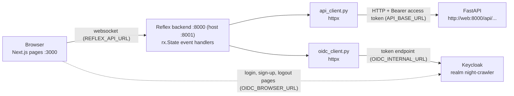
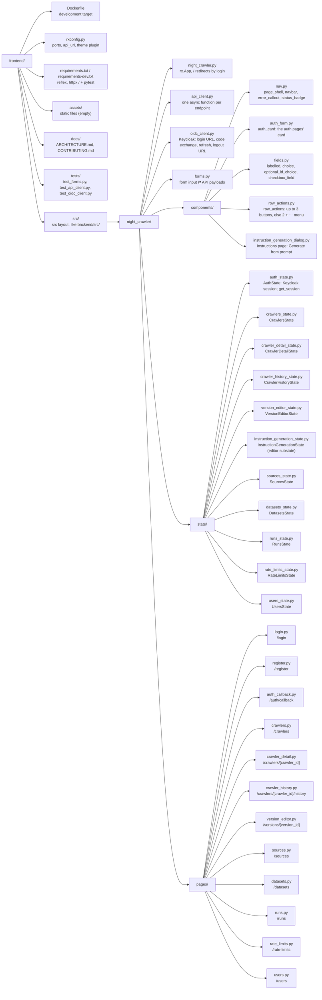

# Frontend Architecture

The frontend is a [Reflex](https://reflex.dev) 0.9 app. Reflex compiles the
Python pages into a Next.js app (port 3000) and runs a Python backend (port
8000 in the container, 8001 on the host) that holds each browser tab's state
and talks to it over a websocket.

## How It Talks to the API

- Every API call is made by an event handler, server side, through
  `api_client.py`. The browser never calls FastAPI, so FastAPI needs no CORS.
- `API_BASE_URL` (Compose: `http://web:8000`) is where the Reflex backend
  finds FastAPI. `REFLEX_API_URL` is where the *browser* finds the Reflex
  backend (dev: `http://localhost:8001`).
- A non-2xx response raises `ApiError(status_code, message)`; the message is
  the API's own `{"message"}`, or FastAPI's validation `detail` joined into
  one line. An API that can't be reached (down, restarting, timing out)
  raises `ApiError(503, "The API is unreachable. Try again shortly.")`.
  States show it in a red callout.

## Project Structure

The package is `night_crawler`, the same name as the backend's; the two
never share an interpreter (each has its own container), so they don't clash.
`PYTHONPATH` (set in the Dockerfile) points at `src/`, and Reflex loads
`night_crawler.night_crawler` because `app_name` is `night_crawler`.

Nested crawler routes show ancestor breadcrumbs on their own line, with the
current page title below at a consistent left edge. Version instructions
show **Crawlers / Version History** in the breadcrumb, **Instructions** as
the page title, and the crawler name plus version status as a subtitle.
All pages share the `page_shell` size-4 maximum content width and a responsive
20rem minimum that contracts to the viewport on narrow screens. Top-level
pages use the navbar as their primary navigation.
The version editor's templates toolbar groups **Version history**, **Test
run**, and **New template**. **Publish** remains beside the version heading.

## Pages

| Route | State | What it does |
|-------|-------|--------------|
| `/login`, `/register`, `/auth/callback` | `AuthState` | `/login` has **Log in** and **Create one**, which send the browser to Keycloak's login or sign-up page (`prompt=create`); `/register` goes straight to the sign-up page. Keycloak sends it back to `/auth/callback`, which finishes the login (see [Authentication](#authentication)) and lands on `/crawlers`, or shows why it couldn't with a link back to `/login`. |
| `/crawlers` | `CrawlersState` | List crawlers; clicking a title or **Instructions** opens the editor on the draft, else the published version (`forms.editable_version_id`), else a new draft. Create a crawler or change it with **Schedule** (title, Source and Dataset picked from the stored ones, fields (the Dataset fields it downloads, comma separated), cron schedule, queue; with none yet it links to `/sources` or `/datasets`). The Source sits next to the dataset because it says where the dataset's records come from; the queue is where every run goes, and never offers `testing` (`forms.CRAWLER_QUEUES`). A schedule always runs the published version; clear it to stop; **Context** opens the Context of the crawler's latest run (test runs excluded), which its next run inherits, except the keys a selector of the published version sets: the API lists them as `harvested_keys`, and the dialog marks them "set by a selector · not inherited" and hides their **Edit** (the API refuses the edit, 409; **Delete** stays; `forms.context_rows`'s `is_harvested`). List its keys, add or edit one (the value is JSON, else plain text: `forms.parse_context_value`), or delete one. Values of keys that look like credentials (`key`, `token`, `secret`, `password`: `forms.is_secret_key`) are masked and never prefilled; a crawler that never ran shows the API's message instead; **History** opens its Execution history; delete. The actions column shows **Schedule** and **Instructions**; **Context**, **History**, and **Delete** (in red) are in the ⋯ menu (`components/row_actions.py`: a row shows up to 3 actions as buttons; past that, the first 2 and a menu with the rest). |
| `/crawlers/[crawler_id]` | `CrawlerDetailState` | The crawler's versions: new draft, publish a draft (which archives the published one), delete a draft or archived one (the API refuses a version that has run). There is no Archive button. **Execution history** opens the crawler's Execution history. |
| `/crawlers/[crawler_id]/history` | `CrawlerHistoryState` | **Execution history**: one crawler's runs of the last 30 days, newest first, test runs excluded, loaded in one request (`api_client.get_execution_history`) plus the summary (`api_client.get_execution_summary`); filtering and paging then stay in memory. The header shows the schedule in plain English (`forms.schedule_text`: daily, hourly, weekly, monthly, and every-N-minutes shapes, other cron as is; schedules run in UTC), **Refresh**, and **Export CSV** (the window's runs under the selected outcome, `forms.build_history_csv`, `forms.history_csv_filename`, `rx.download`). Four cards (`forms.history_summary`, `forms.split_time_ago`): **Current streak** (successful runs, green), **Last verification failure** (amber) and **Last failed run** (red, cancelled runs included) as "5 days ago", and **Success rate** over the last 30 ended runs with the average completeness. The table (`forms.history_rows`) shows the execution date ("Oct 7, 2026", **Latest** on the newest run), start and end time (UTC), duration, one status badge from the API's `outcome` (Success, Verification failed, Failed, In progress), records extracted (`dataset.row_count`), and completeness rate (`validation.completeness_rate`, amber for a verification failure, "–" without one). 12 rows per page with "Showing 1–12 of 30" (`forms.page_slice`, `forms.showing_text`, `HISTORY_TABLE_PAGE_SIZE`); a note says when the window held more than 1,000 runs. Above the table, **Runs · last 30 days**: chips **All** · **Success** · **Verification failed** · **Failed**, each with the API's count for the whole window (`forms.chip_options`; cancelled runs are in Failed), select an outcome (`outcome_filter`), which narrows the table (back to page 1) and the export (`forms.filter_runs_by_outcome`). The chart (`rx.recharts.scatter_chart`) has one point per ended run, oldest on the left, at its completeness rate, with a thin stem up from the axis (an `error_bar` from the floor), coloured by outcome with theme tokens (`--green-9`, `--amber-9`, `--red-9`). A run without a rate (a failed run, or one validated before the rate existed) is a red × on the axis. The y-axis starts 1 point under the lowest rate, rounded down, and never above 94% (`forms.chart_floor`). There is no threshold line: verification is rule-based, not a percentage. The chip never removes points: the ones it leaves out drop to 25% opacity. Each point lands in one of `forms.CHART_SERIES` (outcome or no data × highlighted or dimmed, `forms.chart_points`, `forms.chart_series`), so every `scatter` has a single fill, shape, and opacity. The tooltip shows the run's date, outcome, records, and completeness through a Recharts `formatter` passed as JavaScript (`custom_attrs`, the wrapper has no prop for it). First and last dates sit under the chart with the caption "Completeness per run · × no data". Opened from **History** on the crawler list, or **Execution history** on the crawler page. |
| `/datasets` | `DatasetsState` | List Datasets (the built-in `venues`, `reviews`, `menus`, plus any added) with a summary of their fields (`forms.fields_summary`: `*` required, `!` unique, `:type`, `~pattern`); create one (fields as a JSON list, `forms.build_dataset_payload`). Only admins see **Edit** and **Delete**; the API refuses deleting a Dataset a crawler uses, or an edit that would break a linked crawler's schema. |
| `/runs` | `RunsState` | Every crawler's runs, newest first, test runs included. Filters: crawler name (a debounced text box, any part of the title), queue, status, and parsing status (`forms.execution_params`). Cards for the runs shown: % succeeded, failed count, and average wait in the queue (`forms.runs_summary`). The table shows each run's execution ID (to use with `/api/crawler-executions/{id}`), a **Sample CSV** button that downloads, once the run has ended, a sample of its dataset CSV for a data quality check: at most 800 rows spread evenly over the whole run, the same on every download (`forms.has_csv`, `api_client.download_execution_sample_csv`, `rx.download` with bytes so CRLF line endings survive, named as the API's `Content-Disposition` says: `<crawler_id>_<execution_id>_<started>-sample.csv`, with the run's start time; the full CSV stays available from the API, `GET /api/crawler-executions/{id}/dataset.csv`), links it to its crawler, and shows how long it **Waited** before a worker started it and how long it **Ran for** (`forms.seconds_between`, `forms.format_duration`; `—` until it has). Unfiltered it pages 50 at a time (**Previous** / **Next**); filtered it shows the 50 newest matches. **Refresh** reloads; nothing polls. |
| `/rate-limits` | `RateLimitsState` | List the reusable rate-limit rules (name — by convention the domain it is for, e.g. `places.googleapis.com` —, limit such as `5/second`, and a penalty summary: `forms.rate_limit_summary`) and create one (`forms.build_rate_limit_payload`; blank numbers take the API's defaults). Only admins see **Edit** and **Delete**; deleting asks first, because templates and proxies using the rule lose it. Runs wait on these rules (docs/ARCHITECTURE.md, **Rate limits**). |
| `/sources` | `SourcesState` | List Sources and create one (name, website). Only admins see **Edit** and **Delete** (`AuthState.role`); the API refuses deleting a Source a crawler still uses. The crawler list and crawler page show each crawler's Source by name (`forms.names_by_id`). |
| `/users` | `UsersState` | Admins only: the navbar shows **Users** when `AuthState.role` is `admin`, and the API answers anyone else's request with 403, shown in the page's red callout. Lists Keycloak's accounts by email (email, role, **Enabled**/**Disabled**, created, "—" for accounts imported with the realm), 50 at a time with **Previous** / **Next** (`api_client.list_users`, `USERS_PAGE_SIZE`). **New user** takes an email and a temporary password, which the user must replace at their first login; the API starts every new account as `user`. **Edit** changes the email, the role (`user`, `admin`, `viewer`: `forms.USER_ROLES`), and sets a new temporary password, which a blank field skips (`forms.build_user_payload`). **Disable** (enabled accounts only) asks first, then calls `api_client.disable_user`: the user can no longer log in, and their crawlers, versions, and runs stay; accounts are never deleted. The API refuses demoting or disabling the last enabled admin, a taken email, and a weak password; the dialog or page shows its message. |
| `/versions/[version_id]` | `VersionEditorState` | The version's instructions. **← Crawlers** returns to the crawler list; **Version history** opens the crawler's version list. A **Publish** button next to the heading appears only on a draft: it publishes it (the API archives the published version), reloads it as published, and says "Published.". Settings on top: the version's host session sharing (the crawler's Source is set in the **Schedule** dialog, not here); the proxy ladder is not offered, since no crawl reads it yet, then the **Message templates** table (create, edit, delete, make root; an **Aid** column summarises each template's aid). Each template has a **Selectors (N)** button: clicking it (or the template's URL) opens that template's message selectors, as a tree, in a row right under it; clicking again closes it, and one template is open at a time (`selected_template_id`, `forms.toggle_selection`). Selectors and aids load with the templates, so opening one needs no request. Selector titles matching the crawler's **Fields** are bold and their rows are tinted green; all other titles feed Context. A template has at most one aid, so the aid's fields are always part of the template dialog. Saving the dialog saves the template, then, on the template the API returned (the clone after an auto-fork), puts the aid — unless it sets nothing beyond the defaults (`forms.is_default_aid`), in which case no aid is stored and an existing one is deleted. After an edit, the template it landed on stays open, including across the redirect to a forked draft. In the template dialog's aid, **Add rate limit** reads the URL's host (`forms.url_host`; a `{{placeholder}}` host has none) and selects the rule named after it (`forms.find_rate_limit_for_host`), or opens a form prefilled with that name that creates the rule and selects it. **Export** downloads the version's instructions as a YAML file (`api_client.export_instructions`, `rx.download`, named by `forms.instructions_filename`); **Import** (disabled on an archived version) opens a dialog to upload a `.yaml`/`.yml` file (`rx.upload`, `forms.decode_instructions_file`, `api_client.import_instructions`), which replaces every template, selector, and aid; on a published version the API puts the file on a new draft, which the editor then opens. The file's rules are in docs/DOMAIN_MODEL.md §5.9. **Generate from prompt** (disabled on an archived version; `InstructionGenerationState`, a substate of the editor's, with its dialog in `components/instruction_generation_dialog.py`) asks the AI agents to write the instructions. The dialog takes a prompt and shows the crawler's fields as a reminder of what will be extracted. It warns that generating replaces the draft's instructions, like an import. Submitting builds the body with `forms.build_generation_payload` (trimmed, required, at most 4,000 characters) and calls `api_client.create_instruction_generation`. A background event then polls the job and its test run (below), with a spinner and one status line (`forms.generation_status_text`). The dialog can be closed and the job goes on on the server; reopening it resumes following a job still going. Once it succeeded, the editor opens the version the file landed on: a new draft when a published version forked (`rx.redirect`), else this version reloaded. It shows the generation's `warnings` in yellow callouts and lists its `required_context_keys` (names only) to set in the crawler's Context (Crawlers page → **Context**). It then follows the test run (`api_client.get_execution`): status, request and error counts, and **Sample CSV** (`api_client.download_execution_sample_csv`, as on Runs). A failed job shows the API's `error` in the dialog's red callout, with the prompt kept to edit and resubmit. The backend pipeline is in docs/ARCHITECTURE.md, **Instruction Generations**. |

## Background Polling

Only the **Generate from prompt** dialog polls. `InstructionGenerationState.poll_generation` is an `@rx.event(background=True)` handler: every 3 seconds it fetches the generation (`api_client.get_instruction_generation`, `GET /api/instruction-generations/{id}`, without the recording) and, once it has succeeded, its test run (`api_client.get_execution`). It does this outside the state lock (`async with self` only to read and write vars), and stops when both have ended (`forms.has_ended`) or an API error shows.

Each loop runs on a `poll_round`. Closing the dialog, or the page unmounting (the editor's `on_unmount`, since Reflex has no unload event), starts a new round, which ends the older loop. The page's `on_mount` resumes polling for an open dialog whose job is still going, e.g. after the redirect to a forked draft. Nothing else in the UI polls; the Runs page reloads on **Refresh**.

## Authentication

Accounts live in Keycloak (the root [docs/ARCHITECTURE.md](../../docs/ARCHITECTURE.md#identity-provider)).
The UI logs in as `night-crawler-ui`, a confidential client, with the
Authorization Code flow and PKCE. Keycloak calls go through
`oidc_client.py`, never `api_client.py`:

1. **Log in** / **Create one** (`AuthState.start_login` / `start_register`)
   builds Keycloak's authorize URL (`oidc_client.create_login_request`:
   a random `state`, a PKCE verifier and its S256 challenge, `prompt=create`
   for sign-up), keeps `state` and the verifier in backend-only vars
   (`_login_state`, `_code_verifier`: never sent to the browser), and
   redirects the browser there (`OIDC_BROWSER_URL`).
2. Keycloak sends it back to `/auth/callback`. `AuthState.finish_login`
   checks the `state` against this tab's (`oidc_client.check_callback`:
   a mismatch, a missing code, or Keycloak's `error` is shown instead),
   then trades the code and verifier for tokens on the token endpoint
   (`oidc_client.exchange_code`, `OIDC_INTERNAL_URL`, with the client
   secret, `OIDC_CLIENT_SECRET`, which Compose maps from
   `KC_NIGHT_CRAWLER_UI_SECRET`).
3. The access token, email, and role go in cookies (`nc_access_token`,
   `nc_email`, `nc_role`, 10 hours: Keycloak's default SSO maximum), so
   new tabs are logged in too. The names start with `nc_` because cookies
   don't separate by port and the Importer UI runs on the same host. The
   email and role are read from the token's claims without checking its
   signature (`oidc_client.read_session_user`): they only decide what the
   UI shows; the API verifies the token. The refresh and id tokens stay in
   backend-only vars.
4. Access tokens last 5 minutes. Every handler gets the session through
   `get_session(self)` (`state/auth_state.py`) instead of
   `get_state(AuthState)`: when the token is within 30 s of its `exp`
   (`oidc_client.is_expiring`), it is refreshed first
   (`oidc_client.refresh_session`; Keycloak rotates the refresh token).
   `api_client` itself never retries (FR1.2). If the refresh is refused,
   or the tab has no refresh token (a tab opened later, which only has the
   cookie), the session is cleared: the user is logged out, the page's
   `on_load` sends them to `/login`, and logging in again is one click
   while Keycloak's own session lasts. The **Generate from prompt** poller
   gets a fresh token every round, since a generation outlives one token.
5. **Log out** clears the session and sends the browser to Keycloak's
   end-session endpoint (`oidc_client.build_logout_url`, with the id token
   as `id_token_hint` when this tab has it, else Keycloak asks to
   confirm), which ends the single sign-on session and returns to `/login`.

Every page behind login has an `on_load` handler that redirects to
`/login` when there is no token; `/` sends you to `/crawlers` or `/login`.

Settings (Reflex container environment, defaults match Compose):
`OIDC_BROWSER_URL` (`http://localhost:8180/realms/night-crawler`),
`OIDC_INTERNAL_URL` (`http://keycloak:8080/realms/night-crawler`),
`OIDC_CLIENT_ID` (`night-crawler-ui`), `OIDC_CLIENT_SECRET`, and `APP_URL`
(`http://localhost:3000`; the callback is `APP_URL/auth/callback`, and
logout returns to `APP_URL/login`).

## Versions: Draft, Publish, Archive

The rules live in the API (see the root docs); the UI only reflects them:

- A new crawler comes with draft v1 and an empty root template (shown as
  "(no URL yet)"). The API allows one draft at a time, so "New draft" is
  disabled while one exists.
- Publishing a draft archives the previously published version.
- A new draft clones the published version, else the latest archived one,
  else starts empty. A crawler with every version archived can't happen
  any more (only in older data); **Instructions** recovers from it by opening such a
  draft.
- A published version can't be archived on its own: publishing a draft is
  the only way, so once published a crawler always has a published version.
- Any edit to a **published** version makes the API fork a new draft and
  apply the edit there. After such an edit, `VersionEditorState` looks up the
  crawler's draft and redirects to it. The template the edit landed on (the
  `message_template_id`/`id` in the API's response) stays selected.
- Archived versions are read-only: every edit control is disabled.

## State Conventions

- One `rx.State` subclass per page (`AuthState` is shared by the auth
  pages and `/`); route args (`crawler_id`,
  `version_id`) are the vars Reflex creates for dynamic routes, never
  redefined.
- Dialog forms are uncontrolled (`default_value`) and re-mount through
  `key=` when their target changes. Selects are controlled by a state var
  that the submit handler reads.
- An optional id select uses `forms.NO_SELECTION` for "none", because a
  Radix select can't hold `""`; `forms.blank_to_none` turns it back into
  `null`.
- Payloads are built by pure functions in `forms.py`, which return
  `(payload, error)` and are unit-tested without Reflex.
